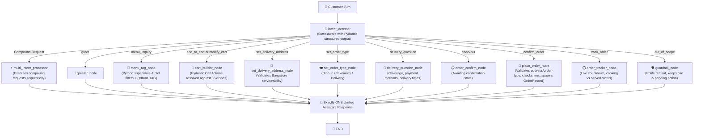

# 🌶️ SpiceRoute Kitchen — LangGraph Food Ordering & Restaurant Management Assistant

[](https://www.python.org/downloads/)
[](https://github.com/langchain-ai/langgraph)
[](https://groq.com/)
[](https://qdrant.tech/)
[](https://fastapi.tiangolo.com/)
[](https://streamlit.io/)
[](tests/)

An enterprise-ready, production-grade conversational food-ordering and hotel restaurant assistant built with **LangGraph StateGraph**, **Groq LLMs**, **FastEmbed**, **Qdrant Cloud**, **FastAPI**, and **Streamlit**.

---

## 🏛️ System Architecture

The core invariant enforced across the entire graph is:
> **`ONE USER TURN = EXACTLY ONE ASSISTANT MESSAGE`**
> Helper steps (menu vector retrieval, availability checking, alternatives matching, address extraction, cart modification) are pure Python functions that update state fields or return intermediate computations. Exactly one terminal node composes the final grounded reply and terminates at `END`.



---

## ✨ Key Features & Capabilities

1. **State-Aware Multi-Intent Engine:**
   - Detects 11 structured intents (`menu_inquiry`, `add_to_cart`, `modify_cart`, `checkout`, `confirm_order`, `track_order`, `set_delivery_address`, `set_order_type`, `delivery_question`, `greet`, `out_of_scope`).
   - Handles compound multi-intent turns (e.g. `"add 1 mango lassi and make it final"` -> `['add_to_cart', 'checkout']`).
   - Enforces state-aware protection: when `pending_action == "awaiting_order_confirmation"`, messages about delivery, address, dining mode, or payments are never marked `out_of_scope`.

2. **Full-Menu Dish Resolution & Strict Category Alternatives:**
   - Expanded 36-dish menu categorized into *Starters*, *Main Course*, *Breads*, *Drinks*, and *Desserts*.
   - Dish additions resolve against the entire menu vector space via top-1 semantic matching above cosine threshold `0.65`.
   - When an item is marked unavailable (e.g. *Mutton Rogan Josh* or *Paneer Butter Masala*), alternative recommendations are strictly locked to the **same category and dietary classification** using Qdrant payload filters.

3. **Multi-Fulfillment Modes (Dine-in, Pickup & Delivery):**
   - **Home Delivery:** Validates city against `SERVICEABLE_CITIES` (Bangalore/Bengaluru); blocks order placement until a valid address is confirmed; adds +15 min transit buffer.
   - **Dine-in:** Captures optional table number; waives address and transit buffer requirements.
   - **Takeaway / Self-Pickup:** Ready directly at `12, Food Street, Bangalore`; no address required.

4. **Concurrent Kitchen Order Lifecycle (Up to 5 Orders):**
   - Pure-Python order state machine in `graph/orders.py`.
   - Maintains order records with ETA, placed timestamp, status (`cooking` vs `served`), and remaining seconds.
   - Live countdown timer syncs on every turn and in the UI. When remaining time hits 0, the order automatically transitions to `served` and frees up the customer's concurrency slot.

5. **Dual Interface: Streamlit UI + Headless FastAPI REST Server:**
   - **Streamlit App (`app.py`):** Interactive tabs (Chat Assistant, Active Orders Tracker, Live Menu Browser, Delivery Info).
   - **FastAPI API (`api.py`):** Fully documented OpenAPI Swagger endpoints for web, mobile, WhatsApp, or POS integrations.

---

## 📁 Repository Structure

```
.
├── api.py                      # Production FastAPI REST API
├── app.py                      # Interactive Streamlit frontend UI
├── config.py                   # Central environment configuration & thresholds
├── Dockerfile                  # Production container definition
├── docker-compose.yml          # Multi-container orchestration (FastAPI + Streamlit)
├── Procfile                    # PaaS deployment entrypoint (Render/Railway/Heroku)
├── render.yaml                 # Infrastructure-as-code for 1-click Render deploy
├── requirements.txt            # Production Python dependencies
├── .env.example                # Environment variable template
│
├── graph/                      # LangGraph StateGraph Architecture
│   ├── graph_builder.py        # Graph compilation & conditional routing
│   ├── state.py                # OrderState, CartItem, OrderRecord, DeliveryAddress TypedDicts
│   ├── orders.py               # Concurrent order lifecycle & timer sync helpers
│   └── nodes/                  # Pure single-responsibility graph nodes
│       ├── intent_detector.py  # Structured multi-intent classification
│       ├── menu_rag.py         # Grounded RAG with superlative & dietary filtering
│       ├── cart_builder.py     # Pydantic structured cart modifications
│       ├── delivery.py         # Address validation & order fulfillment modes
│       ├── order_confirm.py    # Order review & checkout summary
│       ├── place_order.py      # Order validation, ID generation, cart clear
│       ├── order_tracker.py    # Real-time ETA status & order tracking
│       ├── multi_intent.py     # Compound intent sequential executor
│       ├── greeter.py          # Warm restaurant introduction
│       └── guardrail.py        # Out-of-scope redirection
│
├── rag/                        # Vector Retrieval & Knowledge Base
│   ├── qdrant_client.py        # Qdrant client connection, FastEmbed vectors, filters
│   └── ingest.py               # Ingestion pipeline for menu & QA datasets
│
├── data/                       # Ground-Truth Datasets
│   ├── menu.json               # 36 authentic dishes with rich tags, chefs & prices
│   └── golden_dataset.json     # 50 QA pairs with rubrics, intents & difficulty
│
├── eval/                       # Evaluation & Verification Suite
│   ├── evaluate_golden.py      # 50-pair Golden Dataset evaluation harness
│   ├── evaluator.py            # End-to-end multi-turn conversation evaluator
│   └── golden_results.json     # Saved evaluation metrics & test traces
│
└── tests/                      # Automated Pytest Test Suites
    ├── test_api.py             # FastAPI REST endpoint integration tests
    ├── test_cart.py            # Cart reducer, dish matching, and unknown handling
    ├── test_routing.py         # Intent-to-node routing verification
    ├── test_delivery.py        # City serviceability & fulfillment tests
    ├── test_orders.py          # Concurrent orders lifecycle & timers
    └── conversations.json      # 59 multi-turn conversation test scenarios
```

---

## 🚀 Quick Start Guide

### 1. Prerequisites
- Python 3.10, 3.11, or 3.12
- Groq API Key ([console.groq.com](https://console.groq.com/))
- Qdrant Cloud Cluster URL & API Key ([cloud.qdrant.io](https://cloud.qdrant.io/))

### 2. Installation
```bash
# Clone repository
git clone https://github.com/harsh567work-patel/Hotel_Managment_using_LangGragh.git
cd Hotel_Managment_using_LangGragh

# Create and activate virtual environment
python -m venv venv
# On Windows:
venv\Scripts\activate
# On Linux/macOS:
source venv/bin/activate

# Install dependencies
pip install -r requirements.txt
```

### 3. Environment Setup
```bash
# Copy example environment configuration
cp .env.example .env
```
Edit `.env` and provide your credentials:
```env
GROQ_API_KEY=gsk_...
GROQ_MODEL=openai/gpt-oss-120b
GROQ_FAST_MODEL=openai/gpt-oss-20b
QDRANT_URL=https://xxxxxx.region.aws.cloud.qdrant.io
QDRANT_API_KEY=your_qdrant_api_key
```

### 4. Index Knowledge Base into Qdrant
```bash
python -m rag.ingest
```
This loads all **36 menu dishes** and **50 golden QA pairs** into Qdrant Cloud collections with 384-dimensional FastEmbed vectors and payload indices for filtering.

### 5. Run the Application
**Option A: Interactive Streamlit UI**
```bash
streamlit run app.py
```
Open your browser at `http://localhost:8501`.

**Option B: Headless FastAPI Backend**
```bash
uvicorn api:app --host 0.0.0.0 --port 8000 --reload
```
Interactive Swagger UI available at `http://localhost:8000/docs`.

---

## 🐳 Docker & Container Deployment

### Run with Docker Compose (UI + API together)
```bash
docker-compose up --build
```
- **Streamlit Frontend:** `http://localhost:8501`
- **FastAPI Backend & Docs:** `http://localhost:8000/docs`

### Build & Run Individual Docker Container
```bash
# Build image
docker build -t spiceroute-kitchen:latest .

# Run Streamlit UI
docker run -d -p 8501:8501 --env-file .env spiceroute-kitchen:latest

# Run FastAPI API
docker run -d -p 8000:8000 --env-file .env -e PORT=8000 spiceroute-kitchen:latest uvicorn api:app --host 0.0.0.0 --port 8000
```

---

## ☁️ Cloud Deployment Options

### 1. Render (1-Click Blueprint)
1. Fork or push this repository to GitHub.
2. In Render Dashboard, click **New +** -> **Blueprint**.
3. Select this repo — Render will read [`render.yaml`](render.yaml) and automatically create:
   - `spiceroute-kitchen-ui` (Streamlit web service)
   - `spiceroute-kitchen-api` (FastAPI web service)
4. Add your `GROQ_API_KEY`, `QDRANT_URL`, and `QDRANT_API_KEY` in the Render environment variables prompt.

### 2. Railway / Heroku / Koyeb
This repo includes a standard [`Procfile`](Procfile):
```text
web: streamlit run app.py --server.port=$PORT --server.address=0.0.0.0 --server.headless=true
api: uvicorn api:app --host 0.0.0.0 --port=$PORT
```
Simply connect your repository to Railway or Heroku, configure the environment variables, and deploy.

### 3. AWS ECS / GCP Cloud Run
Deploy the container directly to AWS ECS or GCP Cloud Run by pointing to the provided [`Dockerfile`](Dockerfile) and passing the port environment variable (`PORT=8000` or `PORT=8501`).

---

## 📡 REST API Reference

| Method | Endpoint | Description |
| :--- | :--- | :--- |
| `GET` | `/health` | Backend status, Groq model, and Qdrant vector index readiness |
| `GET` | `/menu` | Full 36-dish menu with `category`, `diet` (`veg`/`non-veg`/`vegan`), and `available_only` filters |
| `POST` | `/chat` | Turn execution maintaining session history; returns updated cart, order state & unified reply |
| `POST` | `/orders/track` | Real-time ETA and status query for an active or served order ID |
| `GET` | `/orders/active` | Kitchen dashboard listing all currently cooking orders |
| `DELETE` | `/sessions/{id}` | Reset customer conversation session state |

### Sample Chat Turn (`POST /chat`)
```bash
curl -X POST "http://localhost:8000/chat" \
  -H "Content-Type: application/json" \
  -d '{
    "session_id": "cust_123",
    "message": "I want 2 butter chicken and checkout"
  }'
```

---

## 🧪 Testing & Evaluation Metrics

Run all test suites locally:
```bash
python -m pytest -v
```

### Automated Pytest Suite (44 Tests Passing)
- **`tests/test_api.py`** (7 tests): `/health`, `/menu`, query filters, `/chat` turns, cart updates, order tracking 404, session resets.
- **`tests/test_orders.py`** (4 tests): Multi-order persistence, 5-order concurrency limit enforcement, automatic timer transition to `served`.
- **`tests/test_delivery.py`** (9 tests): Bangalore city serviceability, unserviceable city rejection, dine-in/pickup waiver of address.
- **`tests/test_cart.py`** (10 tests): Addition, removal, quantity update, unknown dish handling, category-locked alternatives.
- **`tests/test_routing.py`** (14 tests): Exact intent-to-node conditional routing and multi-intent compound branches.

### Golden Dataset (50 QA Pairs) Benchmark
Evaluated using [`eval/evaluate_golden.py`](eval/evaluate_golden.py) against the real compiled LangGraph graph:

| Metric | Result |
| :--- | :---: |
| **Total Golden QA Pairs** | **50** |
| **Intent Classification Accuracy** | **100.0%** (50/50) |
| **Deterministic Rubric Pass Rate** | **100.0%** (50/50) |
| **LLM-as-a-Judge Pass Rate (Score >= 0.75)** | **98.0%** (49/50) |
| **LLM Judge Average Score** | **96.7%** |
| **Average Factual Faithfulness** | **95.4%** |
| **Average Completeness** | **95.5%** |
| **Single Assistant Message Invariant** | **100.0%** |
| **Median Latency per Turn** | **15.68s** |

---

## 🔒 Security & Best Practices

- **Zero Secrets in Codebase:** All API keys and secrets load strictly from environment variables (`.env`).
- **Container Hardening:** Runs as a non-privileged `appuser` (UID 1000) inside Docker with non-root permissions.
- **Payload Guardrails:** Strict prompt boundaries prohibit prompt injection or off-topic hallucinations.
- **Strict Vector Fallback Protection:** Refuses silent fallback to in-memory mocks in production, raising explicit startup warnings if vector collections are unreachable.

---

## 📄 License
MIT License. Crafted for **SpiceRoute Kitchen** demonstration and deployment.
