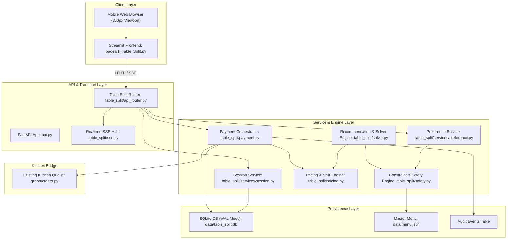
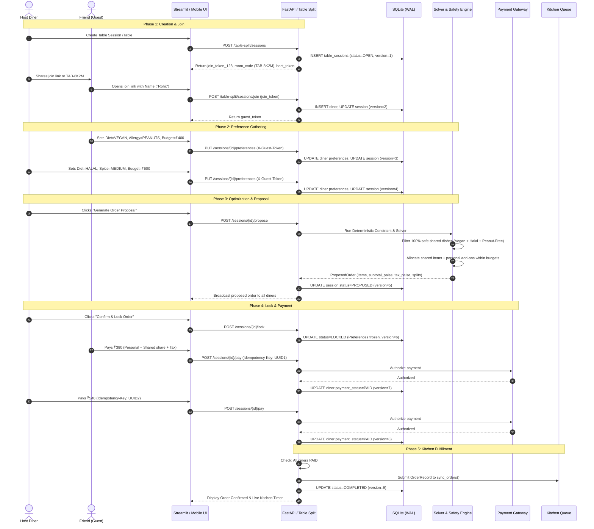

# Table Split Mode — Architecture & Repository Map

## 1. Repository Analysis & Baseline Mapping

The SpiceRoute Kitchen ordering application is a Python-based intelligent conversational food ordering platform. This section documents its existing implementation details and real file paths.

### A. Technology Stack & Frameworks
- **Backend**: Python 3.13, FastAPI `0.115.6` with Uvicorn `0.34.0` in [api.py](file:///d:/langGRAPH/api.py).
- **Orchestration**: LangGraph `1.2.20` StateGraph in [graph/graph_builder.py](file:///d:/langGRAPH/graph/graph_builder.py).
- **Vector DB & Embeddings**: Qdrant Cloud client `1.20.0` with FastEmbed `0.9.1` (model: `BAAI/bge-small-en-v1.5`, 384 dimensions) in [rag/qdrant_client.py](file:///d:/langGRAPH/rag/qdrant_client.py).
- **LLM**: Groq LLM API (`openai/gpt-oss-120b` and `openai/gpt-oss-20b`) via LangChain in [config.py](file:///d:/langGRAPH/config.py).
- **Frontend**: Streamlit `1.67.0` in [app.py](file:///d:/langGRAPH/app.py) with custom dark/ember design system (`#080808` canvas, `#151517` cards, `#FF6B35` orange accents).
- **Persistence (Baseline)**: In-memory dictionary `_sessions: Dict[str, OrderState] = {}` in [api.py](file:///d:/langGRAPH/api.py#L65) and Streamlit `st.session_state` in [app.py](file:///d:/langGRAPH/app.py#L581).
- **Persistence (Table Split Substrate)**: SQLite WAL mode database at `data/table_split.db` managed by [table_split/db/persistence.py](file:///d:/langGRAPH/table_split/db/persistence.py).
- **Testing**: `pytest` 9.2 runner executed via `python -m pytest` with 123 tests in [tests/](file:///d:/langGRAPH/tests/).

### B. Core Subsystem Audits
1. **Menu Storage & Serving**:
   - Master catalog: JSON database at [data/menu.json](file:///d:/langGRAPH/data/menu.json) containing 36 dishes with fields: `id`, `dish_name`, `category`, `description`, `price` (in rupees), `prep_time_minutes`, `is_available`, and `tags`.
   - Vector indexing: [rag/ingest.py](file:///d:/langGRAPH/rag/ingest.py) embeds dish descriptions into Qdrant collection `restaurant_menu`.
   - Retrieval: [rag/qdrant_client.py](file:///d:/langGRAPH/rag/qdrant_client.py) provides cached in-memory access via `get_all_menu_dishes()` and semantic vector search via `search_menu()`.
   - REST endpoint: `GET /menu` in [api.py](file:///d:/langGRAPH/api.py#L186) with category, diet, and availability filtering.
   - Normalized Table Split catalog: [table_split/menu_catalog.py](file:///d:/langGRAPH/table_split/menu_catalog.py) maps dishes to integer paise (`price_paise = rupees * 100`) and tri-state allergen/diet profiles.

2. **Carts & Orders Lifecycle**:
   - State definitions: [graph/state.py](file:///d:/langGRAPH/graph/state.py) defines `CartItem`, `OrderRecord`, and `OrderState`.
   - Cart actions: [graph/nodes/cart_builder.py](file:///d:/langGRAPH/graph/nodes/cart_builder.py) handles item addition, modification, and clearance.
   - Order tracking: [graph/orders.py](file:///d:/langGRAPH/graph/orders.py) synchronizes cooking countdowns via `sync_orders()` simulating transitions from `cooking` to `served` based on `eta_minutes`.
   - Placement node: [graph/nodes/place_order.py](file:///d:/langGRAPH/graph/nodes/place_order.py) validates address or dine-in/pickup mode, generates `ORD-XXXXXXXX` IDs, and appends to `state['orders']`.

3. **Authentication (Current Baseline)**:
   - **Zero authentication exists in baseline**. Any client supplies an arbitrary string `session_id: str = "default_session"` to [api.py](file:///d:/langGRAPH/api.py#L100).
   - No JWT, API keys, session validation, or guest tokens are currently implemented in the base chatbot.

4. **Payments (Current Baseline)**:
   - **Zero payment processing exists in baseline**. Orders transition immediately to confirmed status without monetary transactions, payment gateways, webhooks, or ledgering. Prices in the baseline are raw floats or integers in rupees.

5. **Real-time Synchronization (Current Baseline)**:
   - Frontend: Streamlit `@st.fragment(run_every=1)` in [app.py](file:///d:/langGRAPH/app.py#L163) polls `sync_orders` every second to animate cooking progress bars in the sidebar.
   - Backend: Stateless REST polling via `POST /orders/track` in [api.py](file:///d:/langGRAPH/api.py#L280). No WebSockets or SSE exist in baseline.

---

## 2. Table Split Mode Plug-in Architecture

Table Split Mode integrates into the existing application without disrupting single-user chatbot flows.

### Exact Plug-in Points
1. **New API Router**: Mount `table_split_router` into [api.py](file:///d:/langGRAPH/api.py):
   - `POST /table-split/sessions`: Create new group session.
   - `POST /table-split/sessions/join`: Join session via `join_token_128` or `room_code`.
   - `GET /table-split/sessions/{session_id}`: Fetch session snapshot (private preferences sanitized).
   - `PUT /table-split/sessions/{session_id}/preferences`: Submit/update diner preferences.
   - `POST /table-split/sessions/{session_id}/propose`: Compute optimal group order.
   - `POST /table-split/sessions/{session_id}/lock`: Lock order and generate itemised splits.
   - `POST /table-split/sessions/{session_id}/pay`: Submit per-diner payment with idempotency key.
   - `POST /table-split/webhooks/payment`: Process payment gateway webhooks.
   - `GET /table-split/sessions/{session_id}/events`: SSE endpoint streaming state changes.
2. **New Database Tables** (in [data/table_split.db](file:///d:/langGRAPH/data/table_split.db)):
   - `table_sessions`: Master session metadata, room code, join token, status, `version: int`.
   - `diners`: Member IDs, names, host flag, hashed guest tokens, payment status.
   - `proposed_orders`: Generated shared and personal line items in integer paise.
   - `diner_splits`: Itemised individual breakdowns, shares, tax, tips, and totals in paise.
   - `payment_transactions`: Transaction records, gateway reference, status, timestamps.
   - `payment_idempotency`: Deduplication store for payment requests.
   - `audit_events`: Immutable state mutation ledger.
3. **New UI Page**:
   - [pages/1_Table_Split.py](file:///d:/langGRAPH/pages/1_Table_Split.py): Multi-step mobile-responsive view (Host setup, Guest join, Preference matrix, Group waiting room, Order approval, Itemised pay).
4. **New Background Maintenance Tasks**:
   - `session_reaper`: Periodic task expiring sessions exceeding `TABLE_SPLIT_SESSION_TTL_MINUTES`.
   - `lock_timeout_reaper`: Auto-unlocks sessions where diners abandon payment past 15 minutes.
5. **Kitchen Integration Bridge**:
   - Once 100% of paise are authorized, the `PaymentOrchestrator` translates `ProposedOrder` into an `OrderRecord` and calls `sync_orders` in [graph/orders.py](file:///d:/langGRAPH/graph/orders.py) to begin kitchen preparation.

---

## 3. Full Session Lifecycle & Data Flow

---

## 4. Module Boundaries & Responsibilities

| Module | Responsibility | Key Classes & Functions |
|---|---|---|
| **Session Service** | Room creation, guest admission, room code resolution, lifecycle transitions, optimistic concurrency. | `TableSessionRepository`, `create_session()`, `join_session()`, `lock_session()` |
| **Preference Service** | Diner dietary intake, hardness validation (`HARD` vs `SOFT`), privacy anonymization, free-text parsing boundary. | `DinerPreference`, `submit_preferences()`, `get_sanitized_preferences()` |
| **Constraint Engine** | 100% deterministic safety verification. Enforces tri-state logic (`CONTAINS`/`FREE`/`UNKNOWN`). Unknown allergen/diet strictly fails. | `is_dish_safe_for_diner()`, `find_safe_shared_dishes()` in [table_split/safety.py](file:///d:/langGRAPH/table_split/safety.py) |
| **Recommendation Engine** | Fairness solver, budget constraint enforcement, shared dish vs. personal item partitioning, must-have prioritization. | `OrderSolver`, `solve_optimal_order()`, `explain_allocation()` |
| **Pricing & Split Engine** | Integer paise arithmetic, 5% GST calculation with remainder distribution, zero-penny split guarantee. | `calculate_order_splits()`, `distribute_tax_paise()`, `validate_zero_discrepancy()` |
| **Payment Orchestrator** | Payment state machine, idempotency verification, lock enforcement, webhook processing, kitchen dispatch. | `PaymentOrchestrator`, `process_diner_payment()`, `handle_webhook()` |
| **Realtime / Notification Hub** | Server-Sent Events (SSE) event streaming, polling fallbacks for Streamlit fragments. | `SSEHub`, `publish_session_event()`, `stream_session_events()` |

---

## 5. External Dependencies

| Dependency | Purpose | Version |
|---|---|---|
| `fastapi` | REST API endpoints, routing, middleware | `>=0.115.0` |
| `uvicorn` | ASGI server runtime | `>=0.30.0` |
| `pydantic` | Data validation, strict integer types, schema definitions | `>=2.8.0` |
| `sqlite3` | Zero-daemon ACID persistent storage with WAL mode | Standard Library |
| `secrets`, `hashlib`, `hmac` | Cryptographic token generation and constant-time verification | Standard Library |
| `streamlit` | Multi-page web frontend with responsive mobile layout | `>=1.40.0` |
| `httpx` | Asynchronous HTTP client for webhook/gateway calls and tests | `>=0.27.0` |
| `pytest` | Test runner for safety, money, and lifecycle suites | `>=8.0.0` |
| `ruff`, `mypy` | Static analysis, code formatting, and strict type checking | Installed in virtualenv |
