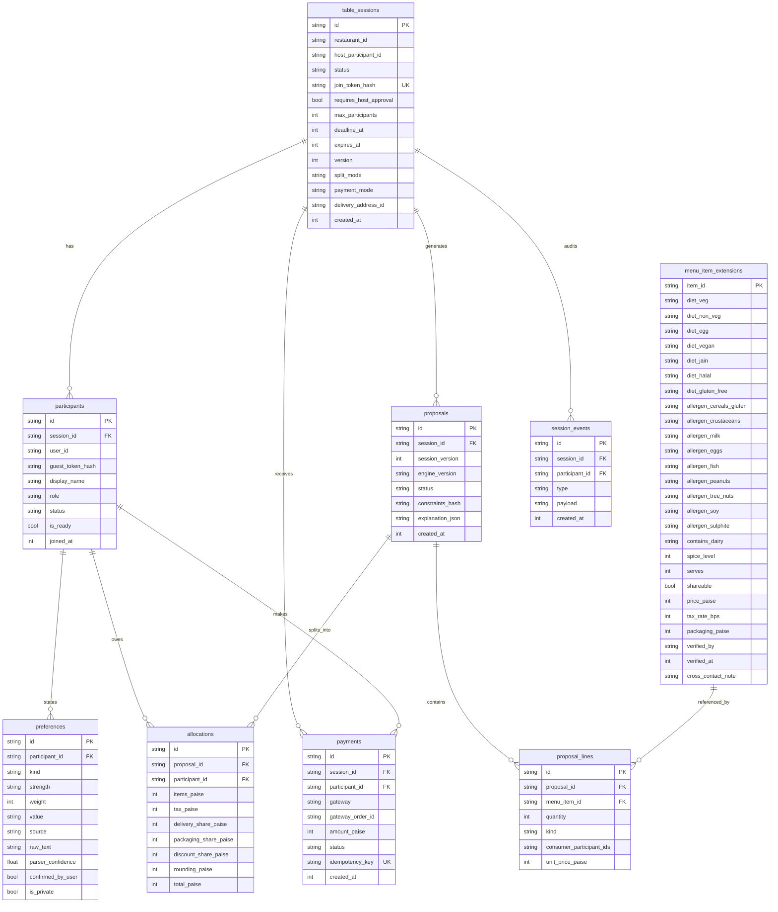

# Table Split Mode: Domain Model & Data Dictionary

This document defines the relational database schema, integrity invariants, and data dictionary for **Table Split Mode** in SpiceRoute Kitchen.

---

## 1. Regulatory Context & Food Safety Compliance

### FSSAI Statutory Basis
All dietary and allergen classifications adhere to the **Food Safety and Standards (Labelling and Display) Regulations, 2020** (FSSAI Notification *F. No. 1-94/FSSAI/SP(L&C)/2020* dated 17th November 2020, Chapter II, Regulation 5(3)(ix)).

Under Indian law, food business operators are required to declare the presence of the following **9 statutory allergen categories**:
1. **Cereals containing gluten**: wheat, rye, barley, oats, spelt or their hybridized strains and products thereof.
2. **Crustaceans** and products thereof (prawns, crabs, lobsters, shrimp).
3. **Eggs** and egg products.
4. **Fish** and fish products.
5. **Peanuts** and peanut products.
6. **Tree nuts** (almonds, walnuts, pistachios, cashews, pecans, hazelnuts, macadamia) and products thereof.
7. **Soybeans** and soybean products.
8. **Milk and milk products** (dairy, khoya, paneer, butter, ghee, curd, cheese).
9. **Sulphite** in concentrations of 10 mg/kg ($10\text{ ppm}$) or more.

### Derived Invariants & Fail-Safe Semantics
- **Tri-State Logic**: Every allergen and dietary attribute is strictly tri-state: `YES`, `NO`, or `UNKNOWN`.
- **Fail-Safe Invariant**: An `UNKNOWN` classification is treated as **UNSAFE** for any diner with a hard restriction.
- **Derived Dairy Rule**: Under culinary and statutory logic, milk allergen presence strictly implies dairy presence:
  $$\text{allergen\_milk} = \text{YES} \implies \text{contains\_dairy} = \text{YES}$$
  Enforced by SQLite database constraint `ck_milk_implies_dairy` and SQLAlchemy model validation.
- **Clinical Preference Strength**: Preferences of kind `allergen` or `diet` **MUST** be `HARD`. Enforced at DB level by constraint `ck_diet_allergen_must_be_hard`.
- **Financial Precision**: All monetary values are strictly non-negative integers in **paise** ($₹1.00 = 100\text{ paise}$). Floating-point values are rejected.

---

## 2. Entity-Relationship Diagram (ERD)

---

## 3. Data Dictionary

### 3.1 `menu_item_extensions`
Extends baseline catalog items with FSSAI allergen classifications, diet flags, portions, and pricing.

| Column | Type | Nullable | Default | Constraints / Invariants | Description |
| :--- | :--- | :--- | :--- | :--- | :--- |
| `item_id` | `VARCHAR(64)` | No | - | PRIMARY KEY | Unique menu item ID (e.g. `D001`). |
| `diet_veg` | `VARCHAR(10)` | No | `'UNKNOWN'` | CHECK in (`YES`, `NO`, `UNKNOWN`) | Vegetarian compliance. |
| `diet_non_veg` | `VARCHAR(10)` | No | `'UNKNOWN'` | CHECK in (`YES`, `NO`, `UNKNOWN`) | Non-vegetarian indicator. |
| `diet_egg` | `VARCHAR(10)` | No | `'UNKNOWN'` | CHECK in (`YES`, `NO`, `UNKNOWN`) | Eggitarian / contains egg. |
| `diet_vegan` | `VARCHAR(10)` | No | `'UNKNOWN'` | CHECK in (`YES`, `NO`, `UNKNOWN`) | 100% plant-based / vegan. |
| `diet_jain` | `VARCHAR(10)` | No | `'UNKNOWN'` | CHECK in (`YES`, `NO`, `UNKNOWN`) | Jain compliant (no root veg, onion, garlic). |
| `diet_halal` | `VARCHAR(10)` | No | `'UNKNOWN'` | CHECK in (`YES`, `NO`, `UNKNOWN`) | Certified Halal. |
| `diet_gluten_free` | `VARCHAR(10)` | No | `'UNKNOWN'` | CHECK in (`YES`, `NO`, `UNKNOWN`) | Gluten-free recipe & prep. |
| `allergen_cereals_gluten` | `VARCHAR(10)` | No | `'UNKNOWN'` | CHECK in (`YES`, `NO`, `UNKNOWN`) | FSSAI: Wheat, rye, barley, oats, spelt. |
| `allergen_crustaceans` | `VARCHAR(10)` | No | `'UNKNOWN'` | CHECK in (`YES`, `NO`, `UNKNOWN`) | FSSAI: Prawns, crabs, lobsters, shrimp. |
| `allergen_milk` | `VARCHAR(10)` | No | `'UNKNOWN'` | CHECK in (`YES`, `NO`, `UNKNOWN`) | FSSAI: Milk & milk products. |
| `allergen_eggs` | `VARCHAR(10)` | No | `'UNKNOWN'` | CHECK in (`YES`, `NO`, `UNKNOWN`) | FSSAI: Eggs & egg products. |
| `allergen_fish` | `VARCHAR(10)` | No | `'UNKNOWN'` | CHECK in (`YES`, `NO`, `UNKNOWN`) | FSSAI: Fish & fish products. |
| `allergen_peanuts` | `VARCHAR(10)` | No | `'UNKNOWN'` | CHECK in (`YES`, `NO`, `UNKNOWN`) | FSSAI: Peanuts & peanut products. |
| `allergen_tree_nuts` | `VARCHAR(10)` | No | `'UNKNOWN'` | CHECK in (`YES`, `NO`, `UNKNOWN`) | FSSAI: Almonds, walnuts, pistachios, cashews. |
| `allergen_soy` | `VARCHAR(10)` | No | `'UNKNOWN'` | CHECK in (`YES`, `NO`, `UNKNOWN`) | FSSAI: Soybeans & products. |
| `allergen_sulphite` | `VARCHAR(10)` | No | `'UNKNOWN'` | CHECK in (`YES`, `NO`, `UNKNOWN`) | FSSAI: Sulphites ($\ge 10\text{ ppm}$). |
| `contains_dairy` | `VARCHAR(10)` | No | `'UNKNOWN'` | CHECK (`allergen_milk != 'YES' OR contains_dairy = 'YES'`) | Derived dairy indicator. |
| `spice_level` | `INTEGER` | Yes | `NULL` | CHECK (`spice_level IS NULL OR (0 <= spice_level <= 4)`) | Heat rating: 0 (None) to 4 (Extreme). |
| `serves` | `INTEGER` | No | `1` | CHECK (`serves > 0`) | Portions fed by 1 unit. |
| `shareable` | `BOOLEAN` | No | `1` | - | Suitable for multi-person consumption. |
| `price_paise` | `INTEGER` | No | - | CHECK (`price_paise >= 0`) | Base item price in integer paise. |
| `tax_rate_bps` | `INTEGER` | No | `500` | CHECK (`tax_rate_bps >= 0`) | GST in basis points (500 bps = 5%). |
| `packaging_paise`| `INTEGER` | No | `0` | CHECK (`packaging_paise >= 0`) | Container charge in paise. |
| `verified_by` | `VARCHAR(128)`| Yes | `NULL` | - | Auditor or chef who signed off. |
| `verified_at` | `INTEGER` | Yes | `NULL` | Unix epoch seconds | Timestamp of verification. |
| `cross_contact_note`| `TEXT` | Yes | `NULL` | - | Kitchen facility warnings. |

---

### 3.2 `table_sessions`
Tracks the aggregate dining party, token security, lifecycle stage, and split protocol.

| Column | Type | Nullable | Default | Constraints / Invariants | Description |
| :--- | :--- | :--- | :--- | :--- | :--- |
| `id` | `VARCHAR(36)` | No | UUIDv4 | PRIMARY KEY | Unique session identifier. |
| `restaurant_id` | `VARCHAR(64)` | No | `'spiceroute_default'` | - | Restaurant location. |
| `host_participant_id` | `VARCHAR(36)` | Yes | `NULL` | - | Participant ID of session host. |
| `status` | `VARCHAR(32)` | No | `'collecting'` | CHECK in (`draft`, `collecting`, `proposing`, `locked`, `paying`, `placed`, `cancelled`, `expired`) | State machine position. |
| `join_token_hash` | `VARCHAR(64)` | No | - | UNIQUE, INDEX | SHA-256 hash of 128-bit join token. |
| `requires_host_approval` | `BOOLEAN` | No | `0` | - | Gatekeeper setting for joins. |
| `max_participants` | `INTEGER` | No | `12` | CHECK (`max_participants > 0`) | Cap on diner room count. |
| `deadline_at` | `INTEGER` | Yes | `NULL` | Unix epoch seconds | Cutoff for preference collection. |
| `expires_at` | `INTEGER` | No | - | Unix epoch seconds | TTL for room garbage collection. |
| `version` | `INTEGER` | No | `1` | CHECK (`version >= 1`) | Optimistic lock concurrency counter. |
| `split_mode` | `VARCHAR(32)` | No | `'by_consumption'` | CHECK in (`by_consumption`, `equal`) | Fair division strategy. |
| `payment_mode` | `VARCHAR(32)` | No | `'each_pays_own'` | CHECK in (`each_pays_own`, `host_pays_all`) | Settlement protocol. |
| `delivery_address_id` | `VARCHAR(64)` | Yes | `NULL` | - | Target delivery location. |
| `created_at` | `INTEGER` | No | Unix epoch | - | Session creation timestamp. |

---

### 3.3 `participants`
Individual diners in a session, either authenticated members or anonymous guests.

| Column | Type | Nullable | Default | Constraints / Invariants | Description |
| :--- | :--- | :--- | :--- | :--- | :--- |
| `id` | `VARCHAR(36)` | No | UUIDv4 | PRIMARY KEY | Unique participant ID. |
| `session_id` | `VARCHAR(36)` | No | - | FK (`table_sessions.id` CASCADE), INDEX | Parent table session. |
| `user_id` | `VARCHAR(64)` | Yes | `NULL` | - | Authenticated user ID (if signed in). |
| `guest_token_hash`| `VARCHAR(64)`| Yes | `NULL` | INDEX | Hash of cookie guest bearer token. |
| `display_name` | `VARCHAR(64)` | No | - | - | User-facing nickname. |
| `role` | `VARCHAR(16)` | No | `'member'` | CHECK in (`host`, `member`) | Host vs guest permissions. |
| `status` | `VARCHAR(16)` | No | `'active'` | CHECK in (`pending`, `active`, `left`, `removed`) | Participation state. |
| `is_ready` | `BOOLEAN` | No | `0` | - | Has submitted preferences. |
| `joined_at` | `INTEGER` | No | Unix epoch | - | Join timestamp. |

---

### 3.4 `preferences`
Dietary restrictions, allergen alerts, budget caps, and culinary likes/dislikes.

| Column | Type | Nullable | Default | Constraints / Invariants | Description |
| :--- | :--- | :--- | :--- | :--- | :--- |
| `id` | `VARCHAR(36)` | No | UUIDv4 | PRIMARY KEY | Unique preference ID. |
| `participant_id`| `VARCHAR(36)` | No | - | FK (`participants.id` CASCADE), INDEX | Owning participant. |
| `kind` | `VARCHAR(32)` | No | - | CHECK in (`diet`, `allergen`, `budget_max_paise`, `spice_min`, `spice_max`, `cuisine_like`, `dislike_item`, `must_include_category`, `must_include_item`, `freeform`) | Preference type. |
| `strength` | `VARCHAR(10)` | No | - | CHECK in (`HARD`, `SOFT`) | Filter strength. |
| `weight` | `INTEGER` | No | `1` | CHECK (`1 <= weight <= 5`) | Priority weight for soft preferences. |
| `value` | `TEXT` | No | - | JSON serialized payload | Structured payload. |
| `source` | `VARCHAR(32)` | No | `'chip'` | CHECK in (`chip`, `freetext_parsed`, `host_set`) | Origin of preference. |
| `raw_text` | `TEXT` | Yes | `NULL` | - | Original unparsed text input. |
| `parser_confidence`| `FLOAT` | Yes | `NULL` | - | LLM parser extraction confidence. |
| `confirmed_by_user`| `BOOLEAN` | No | `1` | - | Has diner validated parsed input. |
| `is_private` | `BOOLEAN` | No | `0` | - | Hide detail from peers (show generic badge). |

> [!IMPORTANT]
> **Safety Invariant**: SQLite constraint `ck_diet_allergen_must_be_hard` strictly enforces:
> `(kind NOT IN ('diet', 'allergen')) OR (strength = 'HARD')`

---

### 3.5 `proposals` & `proposal_lines`
Solver-generated order proposals with dish selections, quantities, and participant mappings.

#### `proposals`
| Column | Type | Nullable | Default | Constraints / Invariants | Description |
| :--- | :--- | :--- | :--- | :--- | :--- |
| `id` | `VARCHAR(36)` | No | UUIDv4 | PRIMARY KEY | Proposal ID. |
| `session_id` | `VARCHAR(36)` | No | - | FK (`table_sessions.id` CASCADE), INDEX | Parent table session. |
| `session_version`| `INTEGER` | No | - | CHECK (`session_version >= 1`) | Session version snapshot. |
| `engine_version`| `VARCHAR(32)` | No | `'1.0.0'` | - | Recommendation solver version. |
| `status` | `VARCHAR(16)` | No | `'draft'` | CHECK in (`draft`, `active`, `superseded`, `approved`) | Proposal state. |
| `constraints_hash`| `VARCHAR(64)`| No | - | SHA-256 | Hash of inputs used to generate. |
| `explanation_json`| `TEXT` | No | `'{}'` | JSON | Natural language explanations. |
| `created_at` | `INTEGER` | No | Unix epoch | - | Generation timestamp. |

#### `proposal_lines`
| Column | Type | Nullable | Default | Constraints / Invariants | Description |
| :--- | :--- | :--- | :--- | :--- | :--- |
| `id` | `VARCHAR(36)` | No | UUIDv4 | PRIMARY KEY | Line item ID. |
| `proposal_id` | `VARCHAR(36)` | No | - | FK (`proposals.id` CASCADE), INDEX | Parent proposal. |
| `menu_item_id` | `VARCHAR(64)` | No | - | INDEX | Menu item code. |
| `quantity` | `INTEGER` | No | `1` | CHECK (`quantity > 0`) | Order quantity. |
| `kind` | `VARCHAR(16)` | No | `'SHARED'` | CHECK in (`SHARED`, `PERSONAL`) | Item distribution kind. |
| `consumer_participant_ids`| `TEXT` | No | `'[]'` | JSON Array | Array of diner IDs splitting this line. |
| `unit_price_paise`| `INTEGER` | No | - | CHECK (`unit_price_paise >= 0`) | Unit price in paise. |

---

### 3.6 `allocations`
Exact per-person financial breakdown in integer paise.

| Column | Type | Nullable | Default | Constraints / Invariants | Description |
| :--- | :--- | :--- | :--- | :--- | :--- |
| `id` | `VARCHAR(36)` | No | UUIDv4 | PRIMARY KEY | Allocation ID. |
| `proposal_id` | `VARCHAR(36)` | No | - | FK (`proposals.id` CASCADE), INDEX | Parent proposal. |
| `participant_id`| `VARCHAR(36)` | No | - | FK (`participants.id` CASCADE), INDEX | Diner billed. |
| `items_paise` | `INTEGER` | No | `0` | CHECK (`items_paise >= 0`) | Food item cost share. |
| `tax_paise` | `INTEGER` | No | `0` | CHECK (`tax_paise >= 0`) | Pro-rata GST share. |
| `delivery_share_paise`| `INTEGER` | No | `0` | CHECK (`delivery_share_paise >= 0`) | Equal share of delivery fee. |
| `packaging_share_paise`| `INTEGER`| No | `0` | CHECK (`packaging_share_paise >= 0`) | Packaging charges. |
| `discount_share_paise`| `INTEGER` | No | `0` | CHECK (`discount_share_paise >= 0`) | Coupon discount applied. |
| `rounding_paise`| `INTEGER` | No | `0` | - | Nearest rupee rounding adjustment. |
| `total_paise` | `INTEGER` | No | - | CHECK (`total_paise >= 0`) | Net payable by this diner. |

$$\text{total\_paise} = \text{items\_paise} + \text{tax\_paise} + \text{delivery\_share\_paise} + \text{packaging\_share\_paise} - \text{discount\_share\_paise} + \text{rounding\_paise}$$

---

### 3.7 `payments`
Multi-gateway payment records with unique idempotency keys preventing double-charges.

| Column | Type | Nullable | Default | Constraints / Invariants | Description |
| :--- | :--- | :--- | :--- | :--- | :--- |
| `id` | `VARCHAR(36)` | No | UUIDv4 | PRIMARY KEY | Payment transaction ID. |
| `session_id` | `VARCHAR(36)` | No | - | FK (`table_sessions.id` CASCADE), INDEX | Parent table session. |
| `participant_id`| `VARCHAR(36)` | No | - | FK (`participants.id` CASCADE), INDEX | Paying diner. |
| `gateway` | `VARCHAR(32)` | No | `'razorpay'` | - | Payment provider (`razorpay`, `mock`). |
| `gateway_order_id`| `VARCHAR(64)`| No | - | - | Provider order / charge ID. |
| `amount_paise` | `INTEGER` | No | - | CHECK (`amount_paise >= 0`) | Transaction amount in paise. |
| `status` | `VARCHAR(32)` | No | `'created'` | CHECK in (`created`, `pending`, `captured`, `failed`, `refunded`, `partially_refunded`) | Payment lifecycle state. |
| `idempotency_key`| `VARCHAR(64)`| No | - | UNIQUE, INDEX | Cryptographic idempotency key. |
| `created_at` | `INTEGER` | No | Unix epoch | - | Transaction timestamp. |

---

### 3.8 `session_events`
Append-only immutable audit log tracking every state change, diner action, and financial mutation.

| Column | Type | Nullable | Default | Constraints / Invariants | Description |
| :--- | :--- | :--- | :--- | :--- | :--- |
| `id` | `VARCHAR(36)` | No | UUIDv4 | PRIMARY KEY | Audit event ID. |
| `session_id` | `VARCHAR(36)` | No | - | FK (`table_sessions.id` CASCADE), INDEX | Target table session. |
| `participant_id`| `VARCHAR(36)` | Yes | `NULL` | FK (`participants.id` SET NULL) | Acting diner (if known). |
| `type` | `VARCHAR(64)` | No | - | INDEX | Event type (e.g. `DINER_JOINED`, `PAYMENT_CAPTURED`). |
| `payload` | `TEXT` | No | `'{}'` | JSON | Serialized event payload. |
| `created_at` | `INTEGER` | No | Unix epoch | INDEX | Audit timestamp. |
