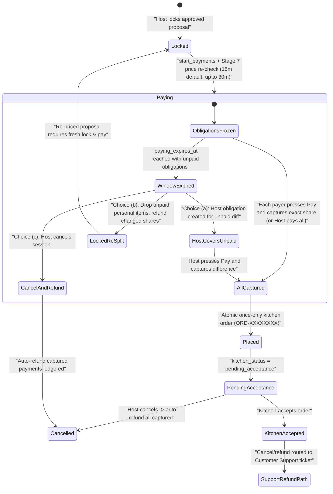

# Table Split Mode — Stage 9 Per-Person Payment Orchestration

## 1. Overview & Safety Guarantees

SpiceRoute Kitchen's Stage 9 payment engine orchestrates multi-payer settlement cleanly without holding card data or ever charging a diner before they explicitly press **Pay**:

- **No multi-payer single gateway order**: Every participant who pays receives a **dedicated gateway order** scoped strictly to their frozen allocation in integer Indian paise (`amount_paise`, `currency="INR"`).
- **Strict integer paise & Stage 7 price re-check**: Moving a locked session to `paying` runs a Stage 7 `PricingEngine` price re-check against current menu prices (`unit_price_paise`, GST basis points, packaging, and delivery fee) before freezing obligations.
- **Zero pre-action charges**: A participant's payment order is created only when that participant invokes **Pay** with an explicit idempotency key.
- **Exact once-only kitchen placement**: Placing a kitchen order happens inside a serialized SQLite `BEGIN IMMEDIATE` transaction enforced by a `UNIQUE(session_id)` constraint on `kitchen_orders` — simultaneous "all paid" triggers can never duplicate an order.

---

## 2. Integrated Provider Capabilities (Razorpay Docs Reference)

The repository models **Razorpay** (`gateway="razorpay"` in `payments`). Based on official Razorpay developer documentation verified prior to Stage 9 implementation:

### 2.1 Supported Payment Instruments in India (NPCI Compliance)

| Instrument | Status in Stage 9 | Notes |
|---|---|---|
| **UPI Intent** (`upi_intent`) | **Supported** | App-to-app mobile handoff via pre-filled `upi://pay?...` deep link; compliant high-success mobile flow. |
| **Dynamic UPI QR** (`upi_qr`) | **Supported** | Scannable dynamic QR URI for desktop and cross-device checkout. |
| **Cards** (`card`) | **Supported** | Credit & Debit card checkout (`method="card"`). |
| **Netbanking** (`netbanking`) | **Supported** | Bank netbanking checkout (`method="netbanking"`). |
| **UPI Collect** (`upi_collect` / VPA pull) | **Disabled / Rejected** | **Deprecated by NPCI effective 28 February 2026** (to eliminate VPA typos and pull-request fraud). Only exempted categories (MCC 6012/6211 securities, existing mandates, e-RUPI, PACB, specific iOS flows) remain permitted on Razorpay; SpiceRoute Kitchen rejects `upi_collect` unconditionally. |

### 2.2 Razorpay APIs & Cryptographic Verification Used

1. **Orders API (`POST https://api.razorpay.com/v1/orders`)**:
   - Binds server-verified `amount` (integer paise), `currency: "INR"`, deterministic `receipt` (`<= 40` chars), and `notes` metadata per participant obligation.
2. **Checkout Signature Verification (`order_id + "|" + payment_id`)**:
   - Verified server-side using constant-time `hmac.compare_digest` with `HMAC-SHA256(key_secret, f"{order_id}|{payment_id}")` before capturing any obligation.
3. **Webhooks (`POST /table-split/webhooks/payment`)**:
   - Header `X-Razorpay-Signature`: verified using `HMAC-SHA256(webhook_secret, raw_unparsed_request_bytes)` **before JSON parsing** so whitespace/key order mismatches cannot pass or trigger false failures.
   - Header `X-Razorpay-Event-Id`: persisted in `webhook_events` (`UNIQUE(event_id)`) so retries and duplicate deliveries are ignored idempotently (`duplicate webhook`).
   - Events handled: `order.paid`, `payment.captured`, `payment.failed`, `refund.created`, `refund.processed`, `refund.failed`.
4. **Order & Payment Reconciliation APIs (`GET /v1/orders/{id}`, `GET /v1/orders/{id}/payments`, `GET /v1/payments/{id}`)**:
   - Scheduled reconciliation polls payments stuck in `created` or `pending` and advances captured, failed, or refunded states deterministically.
5. **Refunds API (`POST /v1/payments/{payment_id}/refund`)**:
   - Triggered automatically for captured payments upon pre-acceptance cancellation, Host expired-window choice **(c) cancel & refund**, reduced splits under **(b)**, or late capture webhooks arriving after session cancellation.

---

## 3. State Machine Diagram



---

## 4. Payment Modes & Host Resolution Paths

### 4.1 `each_pays_own` (Default)
- Each participant sees **Pay** for their exact frozen integer-paise share (`total_paise`).
- Failure for one diner keeps already-captured payments intact; the failed diner may retry within the window.
- If the payment window (`60s..1800s`, default `900s`) expires with unpaid diners, **nothing is placed to the kitchen** until the Host picks one explicit resolution:
  - **(a) `cover_unpaid`**: Creates a dedicated Host obligation for the exact unpaid sum (`frozen_total_paise - already_captured_paise`) and reopens the window for the Host to press **Pay**.
  - **(b) `drop_unpaid_re_split`**: Removes unpaid diners' personal items, re-splits shared items among remaining paying diners via Stage 7 `PricingEngine`, auto-refunds previously captured payments whose amount changed (or all captures if re-locking clean), and returns the session to `locked` so changed amounts require explicit fresh payment start & Pay.
  - **(c) `cancel_and_refund`**: Cancels the session and automatically refunds all captured gateway payments cleanly in `payment_refunds`.

### 4.2 `host_pays_all`
- Only the Host receives a gateway obligation (for `grand_total_paise`).
- Other active participants see `"owes_host"` alongside compliant peer settlement helpers: a `upi://pay?...` **UPI Intent deep link** and a **UPI QR payload string** (no UPI Collect).
- Peer settlements recorded via `POST /table-sessions/{id}/payments/host-settlement` are tagged strictly `informational_only = true` — SpiceRoute Kitchen does not guarantee peer-to-peer repayment.

### 4.3 Late Webhooks & Cancellation Support Boundary
- If a delayed `payment.captured` / `order.paid` webhook arrives **after** the session was cancelled, the orchestrator records the capture, immediately initiates a gateway refund into `payment_refunds`, emits `payment.late_capture_refunded`, and **never** places a kitchen order.
- Cancellation **after** `kitchen_status` reaches `accepted` (or `cooking` / `served`) returns a support-ticket handoff (`refund_mode="support_required"`) instead of an automated gateway refund.

---

## 5. Gateway Test Mode Sandbox Walkthrough (Zero Secrets in Repo)

Never commit real Razorpay credentials (`rzp_live_*`, `rzp_test_*`, secrets) to source control. Configure them solely in local runtime environment variables:

```bash
# Required ONLY when hitting live Razorpay Test Mode sandbox (leave unset to run offline simulator)
export RAZORPAY_KEY_ID="rzp_test_your_key_id"
export RAZORPAY_KEY_SECRET="your_test_key_secret"
export RAZORPAY_WEBHOOK_SECRET="your_test_webhook_secret"
export PAYMENT_GATEWAY_MODE="razorpay_test"  # or default "simulated"
```

### Walkthrough Steps (Test Mode Sandbox)
1. **Generate Test Keys**: In the Razorpay Dashboard, switch the top toggle to **Test Mode**, navigate to *Account & Settings -> API Keys*, generate a `rzp_test_...` Key ID and Key Secret, and configure a Webhook Secret under *Webhooks* pointing to `/table-split/webhooks/payment` for `order.paid`, `payment.captured`, `payment.failed`, `refund.created`, `refund.processed`.
2. **Start Server & Lock Session**: Lock an approved Table Split session (`POST /table-sessions/{id}/lock`) and call `POST /table-sessions/{id}/payments/start` (`payment_mode="each_pays_own"`, `window_seconds=900`).
3. **Create Per-Diner Order**: Each diner invokes `POST /table-sessions/{id}/payments/pay` with `method="upi_qr"` (or `"upi_intent"`, `"card"`, `"netbanking"`) and an `Idempotency-Key`. Razorpay Test Mode creates distinct `order_...` resources (`POST /v1/orders`).
4. **Complete Test Checkout & Verify**: In Test Mode Checkout, choose Netbanking (e.g., SBI/HDFC Success/Failure test bank) or Razorpay test card / QR test success. Submit `(razorpay_order_id, razorpay_payment_id, razorpay_signature)` to `POST /table-sessions/{id}/payments/verify` — verified via HMAC-SHA256 before moving the obligation to `captured`.
5. **Reconcile & Test Refunds**: Invoke `POST /table-sessions/{id}/payments/reconcile` (or wait for background reconciler sweep) to verify pending orders via `GET /v1/orders/{id}/payments`. Test pre-acceptance cancellation via `POST /table-sessions/{id}/payments/cancel` to verify automatic `POST /v1/payments/{id}/refund` ledger entries.
